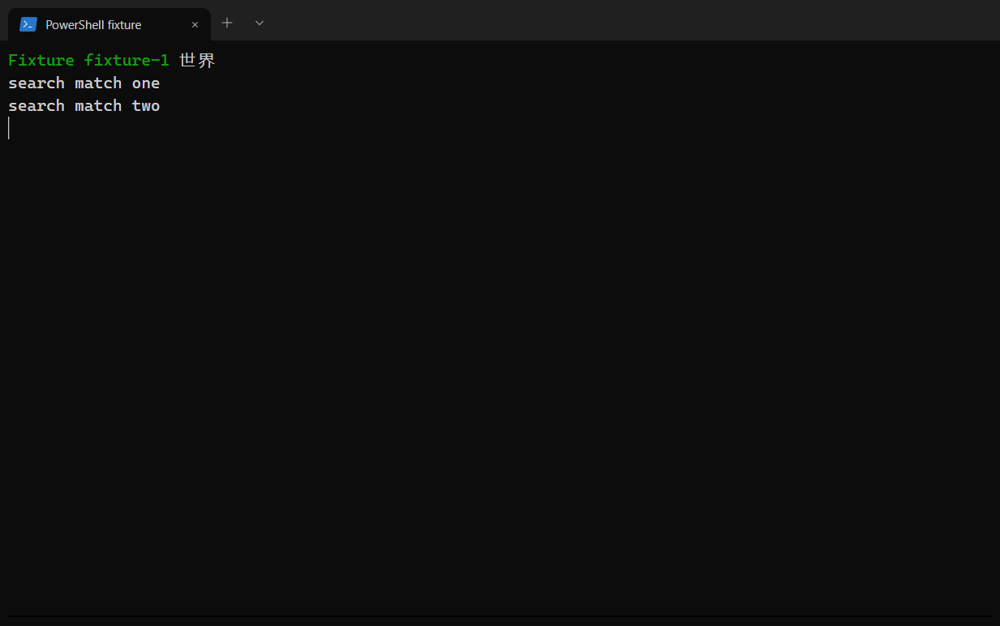
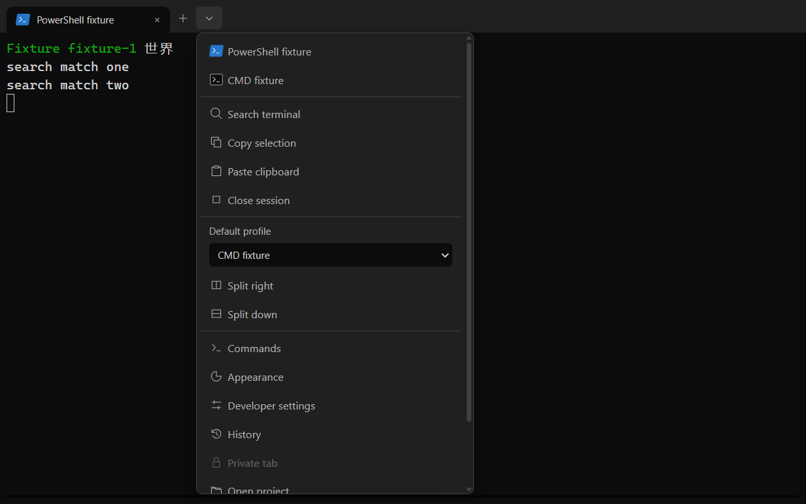

# Theme foundation

The desktop renderer uses the classic dark Windows Terminal appearance approved in #78: a neutral charcoal tab strip, black terminal canvas, Campbell ANSI colors and no accent line or perimeter pane border. Only split dividers separate terminal panes. Native Windows caption buttons remain owned by Electron's title-bar overlay; the renderer reserves their reported width. Terminal One retains its product identity and does not ship Microsoft's application branding.

The renderer consumes locally compiled Tailwind v4 tokens from `src/renderer/src/theme/tokens.css`. No remote CSS, font service or image is loaded. Controls use Segoe UI Variable with Segoe UI and system fallbacks. Shell icons distinguish PowerShell, CMD and Bash; action icons share lightweight square-ended SVG strokes and inherit text color.

## Tabs and controls

Each tab contains its own close button. Arrow keys switch tabs, and closing an inactive tab preserves the active session. The compact plus button uses the selected launch shell. The adjacent profile/options dropdown can open a detected shell directly and exposes pane search, clipboard, stop, split, appearance, projects and developer settings. Escape dismisses it and returns focus to its trigger.

The single-pane view has no duplicate title, pane close button, floating action toolbar or footer. Running state remains available to assistive technology; errors and exit status remain visible. Split panes retain a close control on hover or keyboard focus. Pane actions use a typed renderer ref for the active terminal; no IPC capabilities were added.

## Font and preferences

`TerminalFontConfig` accepts a whitelisted family, integer size 10–32px, finite line height 1–2 and boolean ligature setting. New preferences default to Cascadia Mono, 16px (12pt at 96 DPI), line height 1.2 and ligatures disabled. Consolas and Liberation Mono remain available. Missing fonts use local fallbacks; no font installation is implied.

Existing saved font choices are preserved. The persisted `midnight` theme ID remains valid and is presented as Windows Terminal dark; high contrast remains available. The parser rejects extra fields, invalid metrics and unknown families.

## Focus, contrast and verification

Keyboard focus uses a 2px outline. Token unit checks enforce at least 4.5:1 for UI text and 3:1 for focus and control boundaries. Campbell ANSI colors represent terminal content, including intentionally low-intensity colors; these are separate from UI text tokens.

Desktop smoke tests cover built and development renderers, viewport resizing, keyboard navigation, splits, clipboard, search, appearance and automated WCAG checks. Forced Chromium scaling covers renderer geometry; it does not establish native cross-monitor DPI or packaged Windows compatibility. Historical phase evidence remains in [Phase 0 verification](phase-0-verification.md); current verification belongs in the implementing PR.

The following Windows screenshots use synthetic fixture sessions. They show renderer content; native caption controls and window frames are outside the captured surface.

