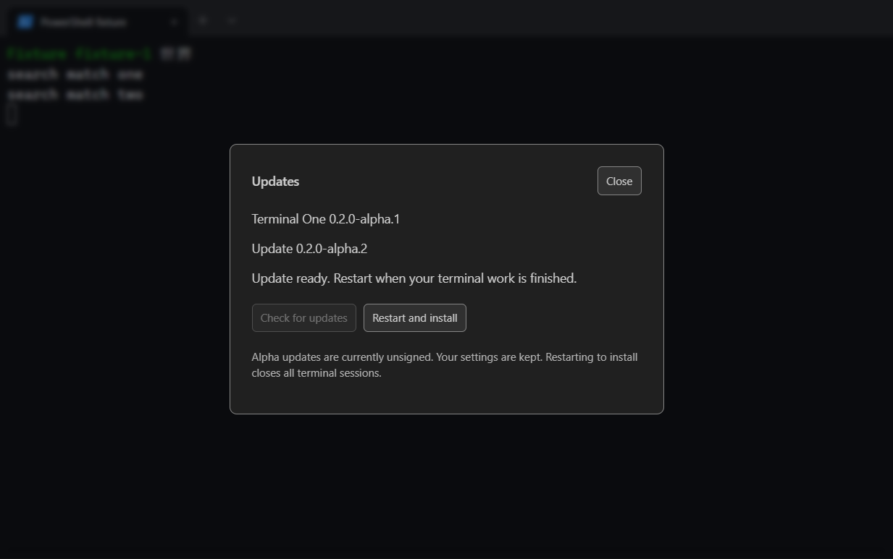

# In-app Windows updates

Installed Windows x64 NSIS builds check GitHub Releases after startup and every six hours. Updates can also be checked from the profile dropdown's Updates entry or the command palette. Development builds remain offline and report that updates require an installed Windows build.

The app checks automatically but does not download or install without a user action. Download progress appears in the Updates dialog. A downloaded update remains ready until Restart and install is chosen; simply closing the app does not install it. A native confirmation warns that running terminal sessions will close. Main shuts down owned sessions and flushes settings before handing the verified installer to electron-updater. Preferences are preserved by the existing per-user NSIS install.

An older build without an updater needs one in-place installation of an updater-enabled build. Uninstalling first is unnecessary. After that migration, subsequent versions can be downloaded and installed from inside the app.

## Channel and integrity

The packaged `app-update.yml` identifies only `dineshkorukonda/TerminalOne` on GitHub. The renderer cannot supply a repository, URL, path, installer argument or version. electron-updater 6.8.9 checks published prereleases, refuses version downgrades and verifies the full installer download against SHA-512 metadata. Full downloads avoid a dependency on differential blockmap assets. Prerelease builds can move forward to supported newer prerelease/stable versions; the current release pipeline publishes alpha versions only.

The existing alpha signing policy is unchanged: installers are unsigned, and the UI states that fact. Hash verification protects download integrity; it does not establish an Authenticode publisher identity. No signing verification override was added. Signed releases and publisher selection still require separate owner approval.

Builds use `publish: 'never'`. A configured GitHub provider emits updater configuration without granting the build permission to publish. The separate existing release bot publishes only from main after its qualification pipeline; feature branches remain non-publishing.

The bot's allowlisted bundle now contains the installer, `SHA256SUMS.txt`, release notes, release manifest and `alpha.yml`. Preparation derives `alpha.yml` from the exact installer bytes. Local and remote validation reconstructs it and rejects changed URLs, sizes or hashes. The release stays draft until all uploaded bytes and metadata have been verified. Update metadata is not uploaded to previously published releases.

## Capability boundary

`getUpdateStatus`, `checkForUpdates`, `downloadUpdate` and `installUpdate` take no arguments. Each handler authenticates the requesting window, main frame and exact document URL. Installation additionally requires a downloaded update and native confirmation. `onUpdateStatus` receives bounded status fields and strips Electron's event object; it returns an idempotent unsubscribe function. Status contains no installer paths, URLs, tokens or raw errors.

## Verification limits

State tests exercise request coalescing, progress bounds, disabled builds, errors, cancellation and shutdown-before-install ordering. Renderer tests exercise check/download/ready/reopen/install states using synthetic updater fixtures. Production smoke tests verify unsupported development mode and rejected malformed calls. Release tests bind updater metadata to installer bytes and prevent corrupted bundles from being published.

These fixtures do not prove an installed old-to-new upgrade. That requires two actual published versions and a clean Windows client. Do not claim end-to-end upgrade success from the fixture tests or from generating an NSIS package alone.

The ready-to-install dialog below uses synthetic versions and an updater fixture; no installer is executed by this renderer test.

